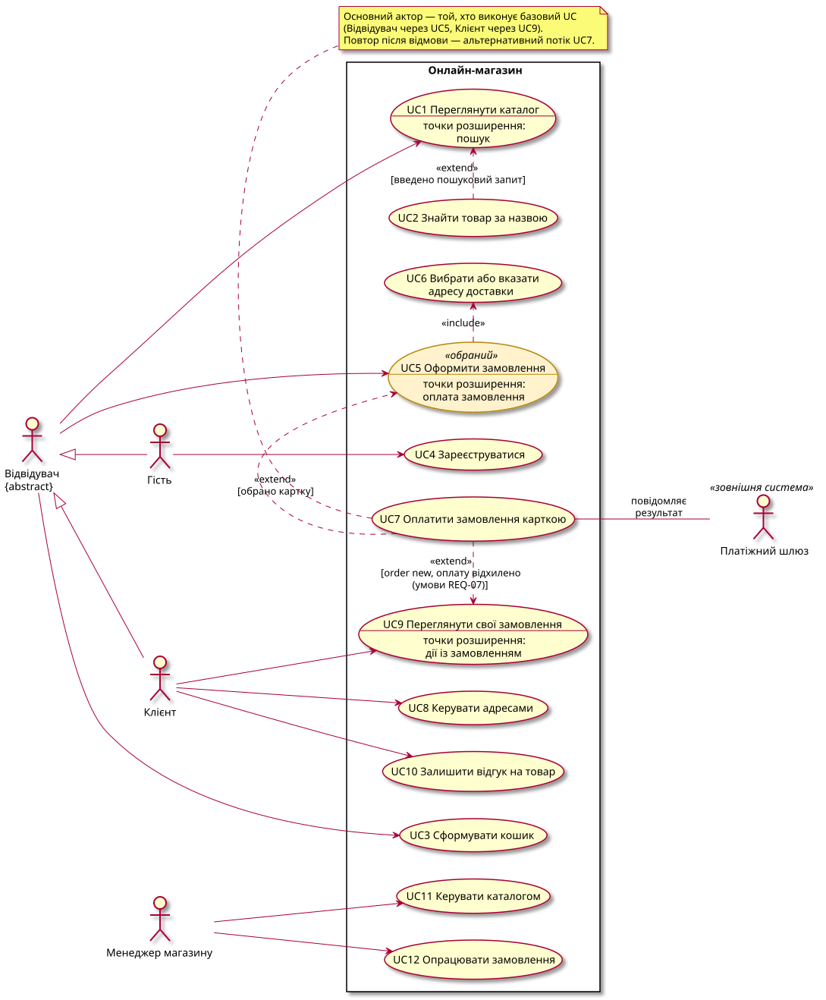

# Актори, прецеденти й UC-діаграма

Діаграма: [`diagrams/uc-diagram.puml`](diagrams/uc-diagram.puml) (джерело), рендер нижче.

## Актори та їхні цілі

| Актор | Хто це | Мета (навіщо приходить) |
|-------|--------|-------------------------|
| Відвідувач (абстрактний) | будь-яка людина на сайті; у кожен момент це або Гість, або Клієнт | знайти потрібний товар і купити його |
| Гість ← Відвідувач | відвідувач без акаунта | купити, не створюючи акаунт, або створити акаунт |
| Клієнт ← Відвідувач | відвідувач, що увійшов в акаунт (`customer`) | купувати швидше зі збереженими адресами, бачити історію замовлень, оцінювати товари |
| Менеджер магазину | працівник магазину | підтримувати каталог актуальним і доводити замовлення до доставки |
| Платіжний шлюз (зовнішня система) | сервіс еквайрингу | другорядний актор UC7: повідомити магазин про результат оплати карткою; сам ініціює цей крок (асинхронне повідомлення) |

Не актори: **система** (вона виконує прецеденти); **служба доставки** й **email-сервіс** (у межах роботи нічого не ініціюють, це деталі реалізації); **таймер** (скасування неоплаченого замовлення — правило системи, записане як EARS, а не чиясь потреба).

## Прецеденти

| UC | Назва | Основний актор | Зв'язки |
|----|-------|----------------|---------|
| UC1 | Переглянути каталог | Відвідувач | точка розширення «пошук» |
| UC2 | Знайти товар за назвою | Відвідувач | `extend` UC1 [введено пошуковий запит] |
| UC3 | Сформувати кошик | Відвідувач | — |
| UC4 | Зареєструватися | Гість | — |
| **UC5** | **Оформити замовлення** | Відвідувач | `include` UC6; розширюється UC7 у точці «оплата замовлення» |
| UC6 | Вибрати або вказати адресу доставки | — (лише через include) | включається в UC5: кожне оформлення проходить через вибір чи введення адреси |
| UC7 | Оплатити замовлення карткою | основний — актор базового UC (Відвідувач через UC5, Клієнт через UC9); другорядний — Платіжний шлюз | `extend` UC5 [обрано картку], `extend` UC9 [`order` `new`, оплату відхилено, умови REQ-07]; повтор після відмови — альтернативний потік самого UC7 |
| UC8 | Керувати адресами | Клієнт | — (переглядає й видаляє адреси, не щоразу вказує нову, тому не включає UC6) |
| UC9 | Переглянути свої замовлення | Клієнт | точка розширення «дії із замовленням» |
| UC10 | Залишити відгук на товар | Клієнт | — |
| UC11 | Керувати каталогом | Менеджер магазину | — |
| UC12 | Опрацювати замовлення | Менеджер магазину | — |

Відсіяно як дії системи, а не потреби актора: «увійти в акаунт» (передумова прецедентів Клієнта, сама по собі цінності не дає), «перевірити наявність», «зафіксувати ціну», «скасувати неоплачене замовлення», «прийняти callback шлюзу».

## Обраний прецедент

**UC5 «Оформити замовлення»** — найскладніший: у ньому беруть участь обидва різновиди Відвідувача, зовнішній актор, три способи оплати, конкуренція за залишок товару й обмеження часу. Межі:

- **початок:** Відвідувач з непорожнім кошиком натискає «Оформити замовлення»;
- **кінець (успіх):** створено `order` і `payment`; для картки — шлюз повідомив результат;
- **кінець (невдача):** замовлення не створено (недійсний кошик, помилка в полі, email з акаунтом, нульова сума, немає товару) або скасовано, бо його не оплатили вчасно;
- **межа з UC7:** оплата карткою — це UC7, вставлений у точці розширення «оплата замовлення» за умови [обрано картку]; повтор після відмови — альтернативний потік UC7. Для відвідувача це шляхи тієї самої потреби, тож сценарії S2, S3, S10, S16 описані в UC5 і позначені тегом `@UC7`. UC7, викликаний з UC9, не розписується;
- **не входить:** формування кошика (UC3), обробка й доставка (UC12), повернення коштів.

Сценарії: [`features/uc5-place-order.feature`](features/uc5-place-order.feature).