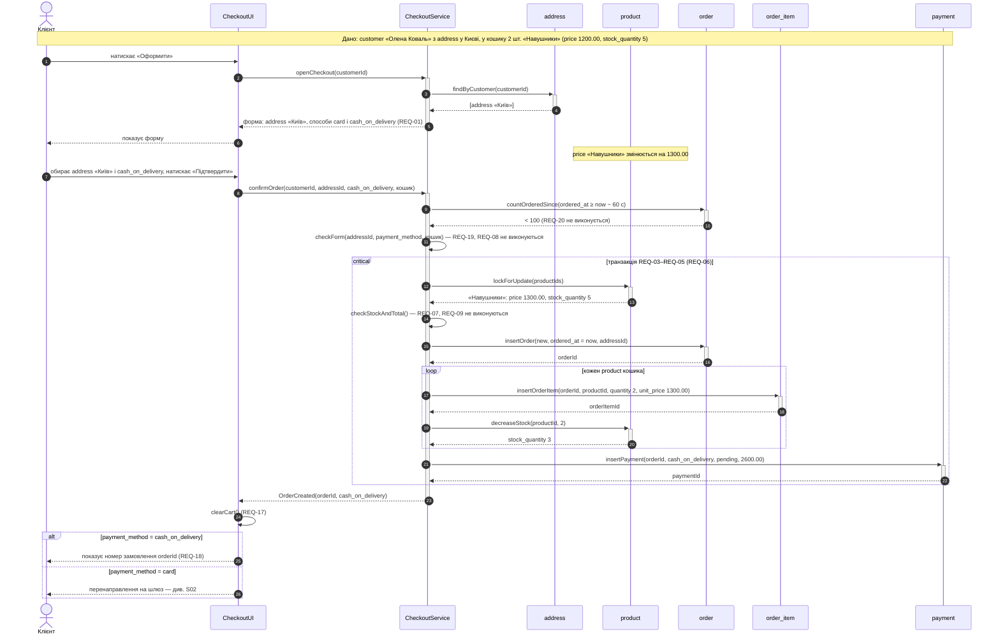

# S01. Клієнт оформлює замовлення з оплатою при отриманні

Сценарій: `@S1` у [`lab2/features/uc2-place-order.feature`](../../lab2/features/uc2-place-order.feature) · вимоги: REQ-01, REQ-03, REQ-04, REQ-05, REQ-17, REQ-18, REQ-22 · рендер: [`svg/S01.svg`](svg/S01.svg)

