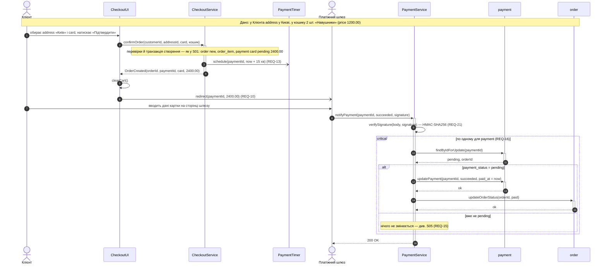

# S02. Клієнт оплачує замовлення карткою

Сценарій: `@S2` у [`lab2/features/uc2-place-order.feature`](../../lab2/features/uc2-place-order.feature) · вимоги: REQ-03, REQ-04, REQ-10, REQ-11, REQ-13, REQ-16, REQ-21 · рендер: [`svg/S02.svg`](svg/S02.svg)

