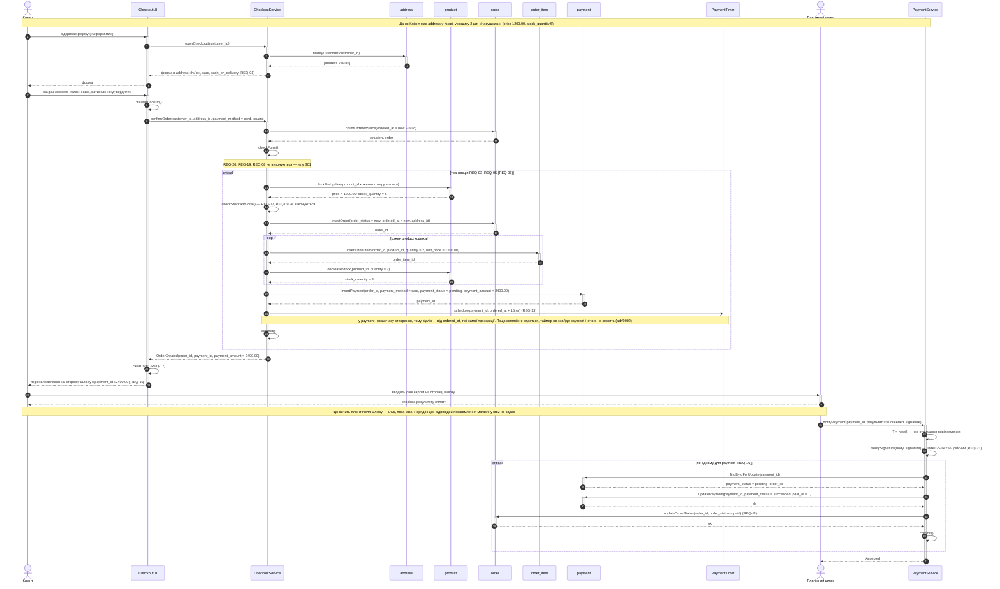

# S02. Клієнт оплачує замовлення карткою

Сценарій: `@S2` у [`lab2/features/uc2-place-order.feature`](../../lab2/features/uc2-place-order.feature) · вимоги сценарію: REQ-03, REQ-04, REQ-10, REQ-11 · також: REQ-01, REQ-05, REQ-06, REQ-07, REQ-08, REQ-09, REQ-13, REQ-16, REQ-17, REQ-19, REQ-20, REQ-21 · кроки інтерфейсу поза lab2: disableConfirm(), кроки шлюзу: Клієнт вводить дані картки, шлюз показує сторінку результату (UC5, поза lab2) · рендер: [`svg/S02.svg`](svg/S02.svg)

