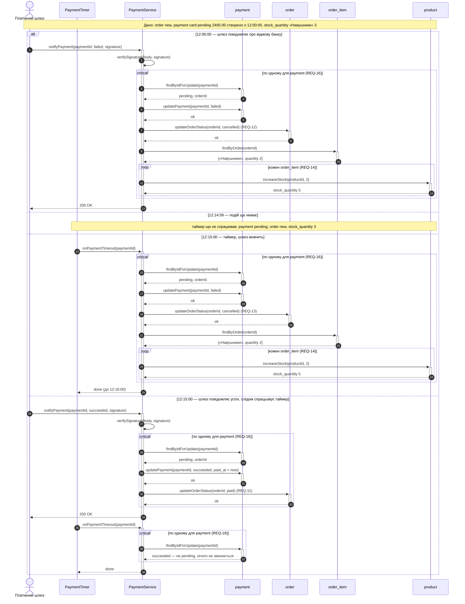

# S03. Оплата карткою завершується подією шлюзу або таймера

Сценарій: `@S3` у [`lab2/features/uc2-place-order.feature`](../../lab2/features/uc2-place-order.feature) · вимоги: REQ-11, REQ-12, REQ-13, REQ-14, REQ-16 · рендер: [`svg/S03.svg`](svg/S03.svg)

