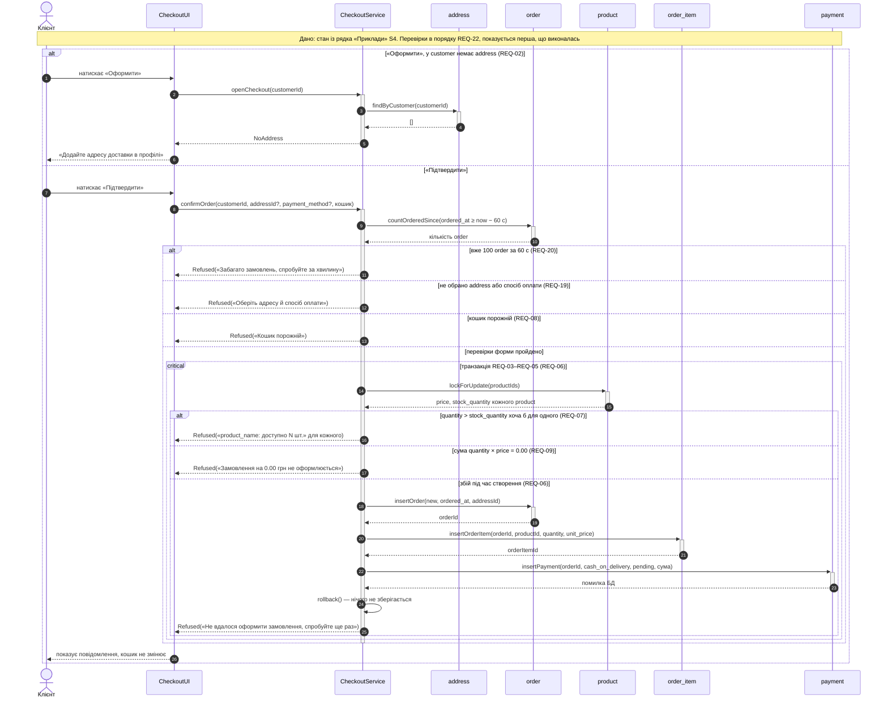

# S04. Оформлення відхилено

Сценарій: `@S4` у [`lab2/features/uc2-place-order.feature`](../../lab2/features/uc2-place-order.feature) · вимоги: REQ-02, REQ-06, REQ-07, REQ-08, REQ-09, REQ-19, REQ-20, REQ-22 · рендер: [`svg/S04.svg`](svg/S04.svg)

