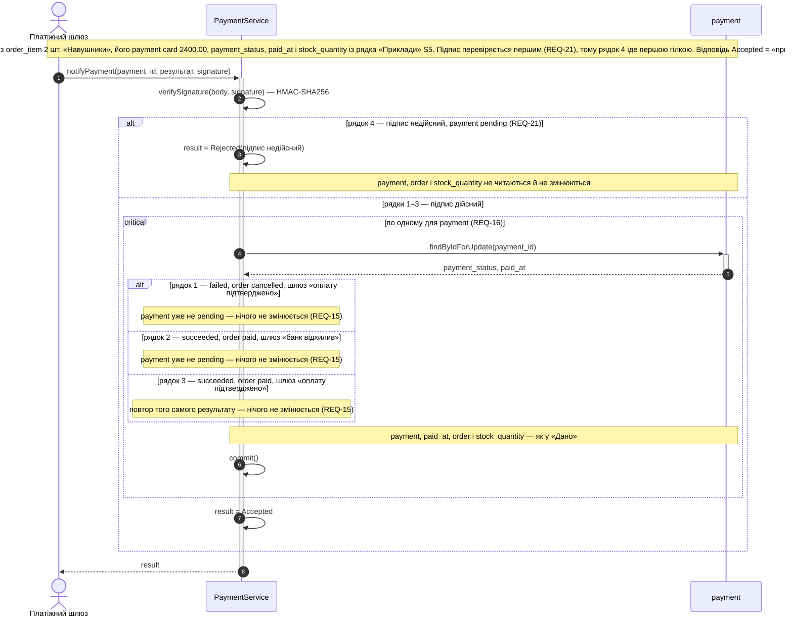

# S05. Повідомлення шлюзу нічого не змінює

Сценарій: `@S5` у [`lab2/features/uc2-place-order.feature`](../../lab2/features/uc2-place-order.feature) · вимоги сценарію: REQ-15, REQ-16, REQ-21 · рендер: [`svg/S05.svg`](svg/S05.svg)

